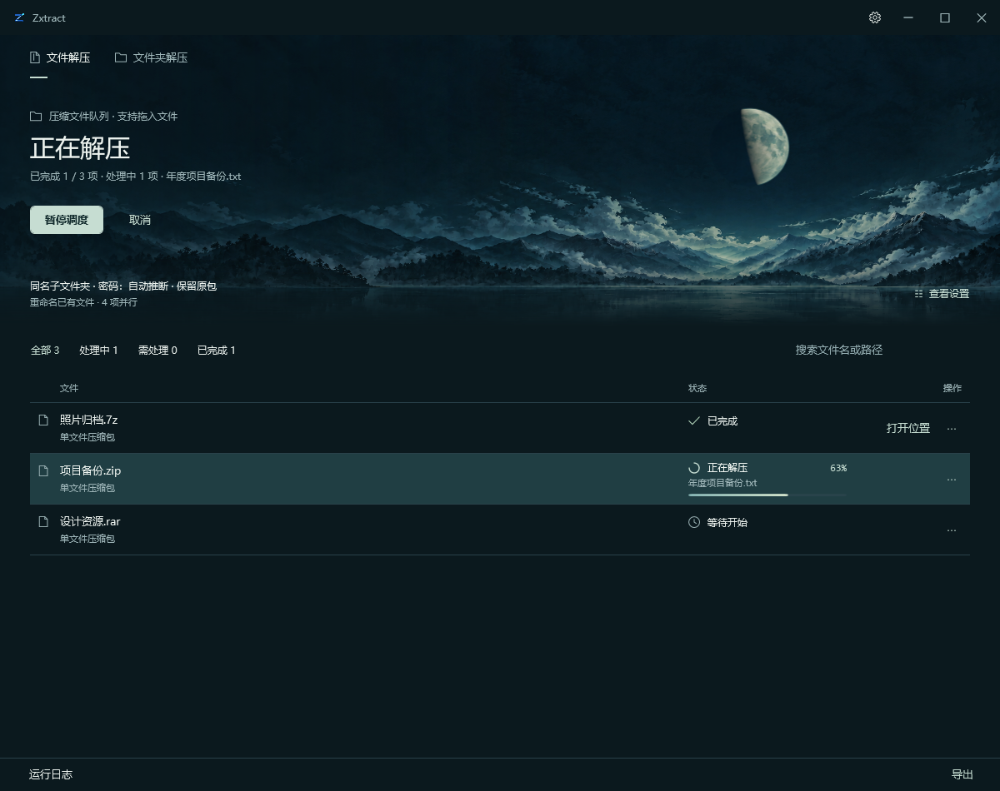
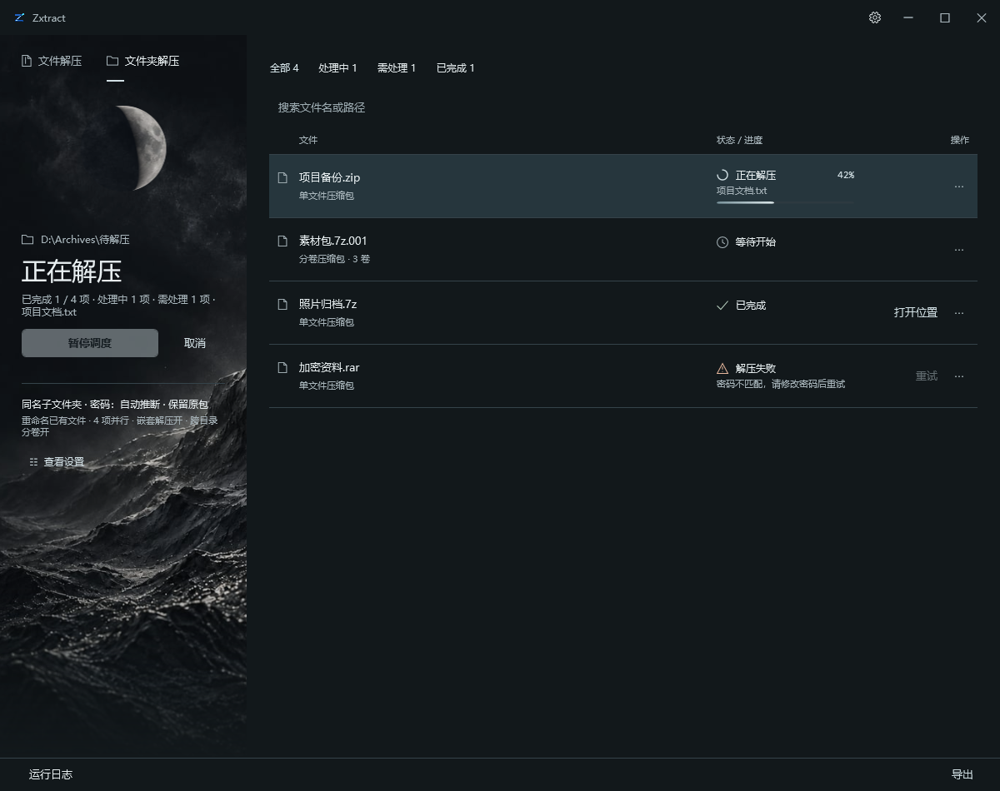
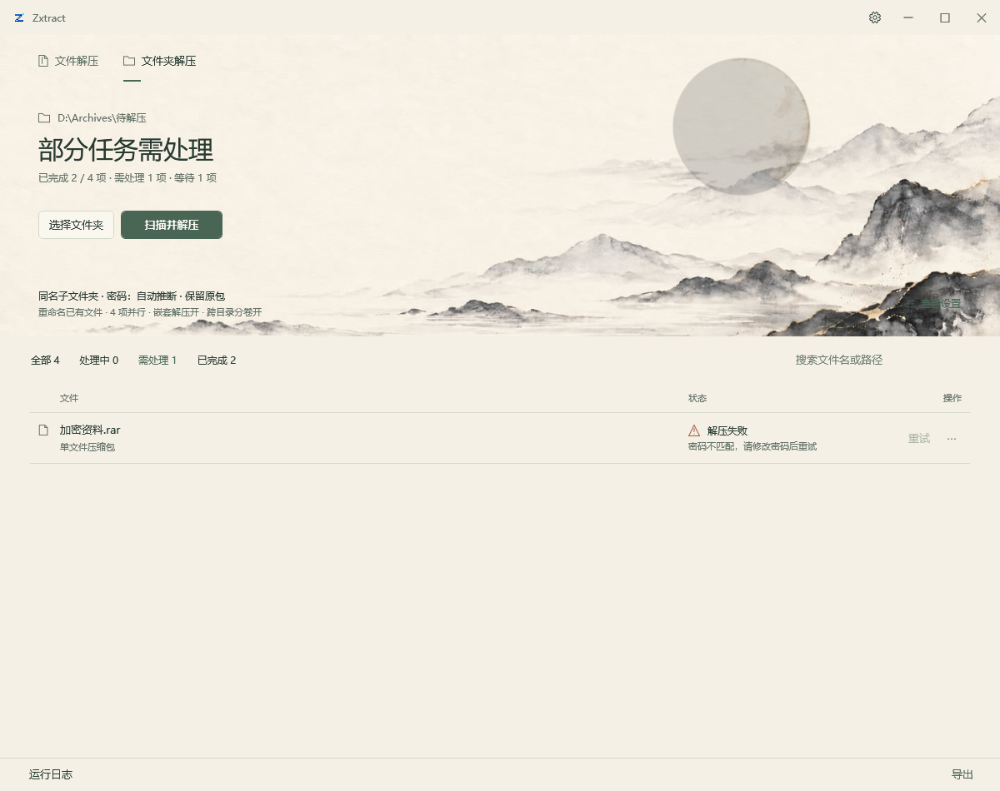
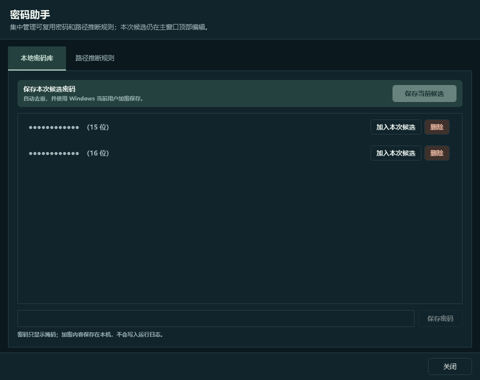
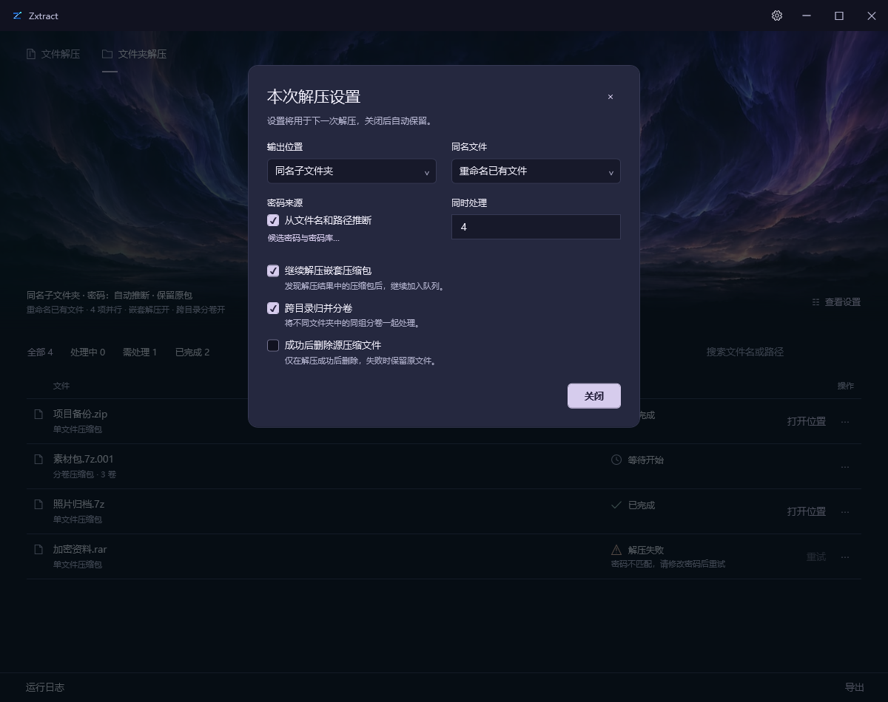
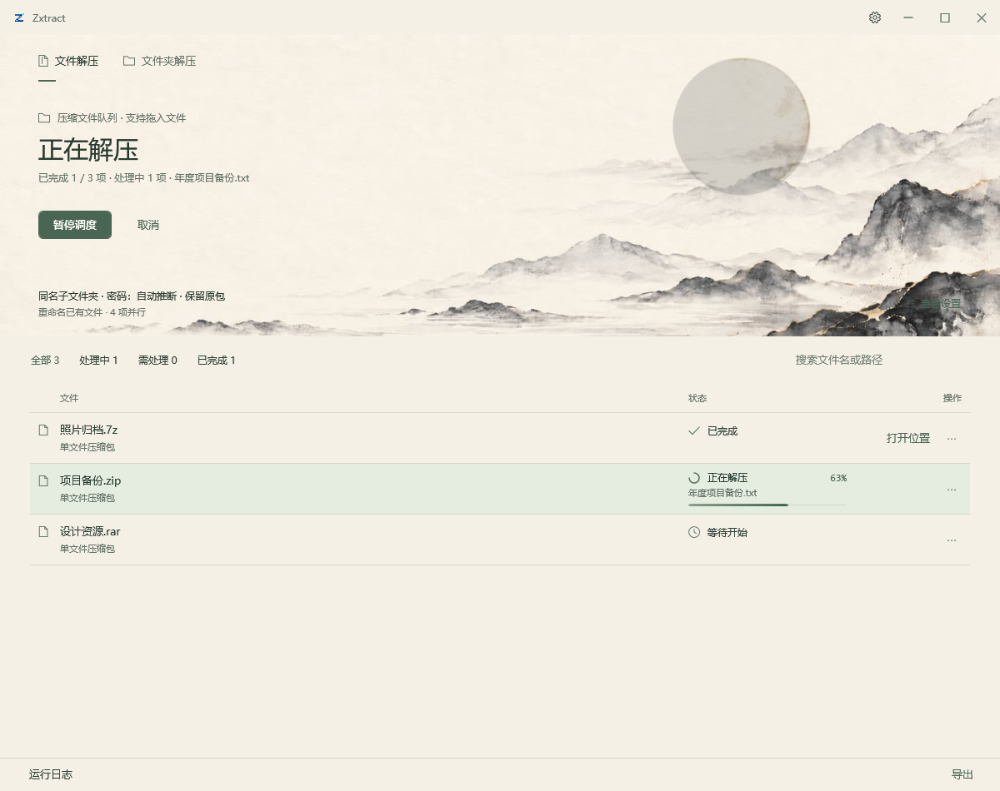
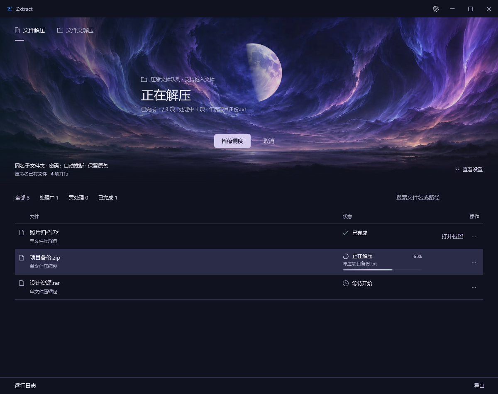
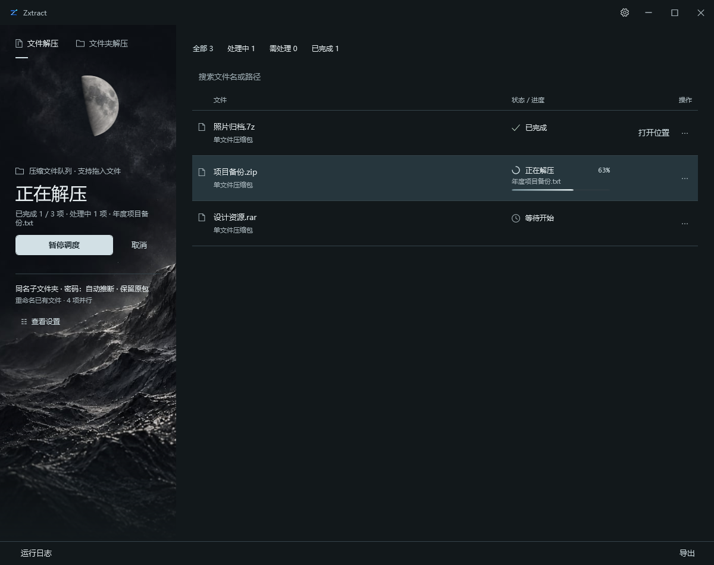

# Zxtract

<p align="center">
  <strong>English</strong> · <a href="README.zh-CN.md">简体中文</a>
</p>

<p align="center">
  <a href="https://github.com/ColonelDarcy2018/Zxtract/releases/latest"></a>
  
  <a href="LICENSE"></a>
</p>

Zxtract is a Windows desktop tool for extracting archive collections. It is built for folders that contain ordinary archives, split volumes, encrypted files, or archives nested inside other archives.

Add individual files or select a root folder. Zxtract groups related volumes, tries password candidates, runs several extraction jobs in parallel, and keeps every result visible in a task list.

> Zxtract extracts archives; it does not create or edit them.

## Highlights

- Separate workflows for individual files and complete directory trees.
- ZIP, 7Z, RAR, TAR and common compressed TAR inputs through the bundled 7-Zip engine.
- Grouping and validation for numeric 7Z/ZIP volumes, `partN.rar`, and legacy RAR volume sets.
- Optional recursive extraction for archives found in extracted output.
- Ordered password candidates, path-based password inference, custom rules, and a local password vault.
- Pause, cancel, filter, search, retry, open-location, and log export controls.
- Safe defaults: keep source files and rename output on conflicts.
- Six built-in skins with instant switching and a remembered appearance preference.

## Interface and workflow

The screenshots below are rendered from the actual 1.1.0 WPF controls with sample tasks, paths, and passwords. The application interface is currently in Simplified Chinese; this README explains the controls in English.

### 1. Add archives directly

Use **File extraction** for a small, known set of archives. Add several files, review the output mode and password candidates, then start the queue. Each row keeps its source path, state, progress, and available action together.



### 2. Scan a directory tree

Use **Folder extraction** when archives are spread across subdirectories. **Scan only** builds the task list without extracting anything; **Scan and extract** continues with the detected work items. Folder mode can group volumes stored in sibling directories and repeat the scan for nested archives.



### 3. Fix only the jobs that need attention

Missing volumes, password failures, and extraction errors remain in the task list. The affected row explains the problem and exposes the relevant recovery action, so a failed batch does not need to be rebuilt from scratch.



### 4. Reuse passwords without putting them in logs

Password candidates are tried in order. Zxtract can infer candidates from file and folder names, reuse entries from the local vault, and apply a corrected password to a failed task.



Saved passwords are protected with Windows DPAPI for the current user. Zxtract stores the encrypted values and rule text in `%LOCALAPPDATA%\Zxtract\password-settings.json`; plaintext passwords are not written to the run log.

### 5. Review extraction options before starting

The moon-scene skins show a two-line summary of output, password source, conflict policy, and parallelism directly on the workbench. Choose **View settings** to edit options in a centered dialog, including nested extraction and cross-directory volume grouping in folder mode. The dialog is read-only while a run is active or paused.



## Download and requirements

The packaged build targets **64-bit Windows 10/11** and includes the .NET runtime plus the 7-Zip extraction engine.

1. Download the latest `Zxtract-<version>-win-x64.zip` from [GitHub Releases](https://github.com/ColonelDarcy2018/Zxtract/releases/latest).
2. Extract the entire ZIP to a writable folder.
3. Run `Zxtract.exe`.

Normal use does not require administrator privileges. Explorer context-menu registration, when used, is created for the current user.

The current release is not code-signed, so Windows SmartScreen may identify it as an unknown publisher. Check the release notes and published checksum before running the package.

## Quick start

### Extract selected files

1. Open **File extraction** and choose **Add files** (`Ctrl+O`), or drag archives into the window.
2. If the archives are encrypted, open **View settings → Password candidates and vault** in a moon-scene skin; enter one candidate per line. Ink Flow and Clear Light have a separate password entry.
3. Under **View settings** (moon-scene skins) or **More options** (Ink Flow/Clear Light), choose the output location, conflict policy, and parallel job count.
4. Select **Start extraction** (`F5`).

### Process a folder

1. Open **Folder extraction** and choose the root directory.
2. Use **Scan only** (`Ctrl+S`) to review detected tasks, or **Scan and extract** to run them. In moon-scene skins, scan-only is available through the shortcut.
3. Under **View settings** or **More options**, enable or disable recursive extraction, cross-directory volume grouping, and source deletion.
4. Review **Needs attention** after the run, then retry only the affected tasks.

### Keyboard shortcuts

| Shortcut | Action |
| --- | --- |
| `Ctrl+O` | Add archive files |
| `F5` | Start file extraction |
| `Ctrl+S` | Scan the selected folder |
| `Ctrl+Shift+E` | Export the run log |

## Supported inputs

| Category | Recognized inputs |
| --- | --- |
| Regular archives | `.zip`, `.7z`, `.rar`, `.tar`, `.gz`, `.bz2`, `.xz`, `.tgz`, `.tar.gz`, `.tar.bz2`, `.tar.xz` |
| Numeric volumes | `.7z.001`, `.7z.002`, ... and `.zip.001`, `.zip.002`, ... |
| RAR volumes | `.part1.rar`, `.part2.rar`, ... and legacy `.rar`, `.r00`, `.r01`, ... |

Extraction support ultimately depends on the bundled 7-Zip engine. For a split set, keep all volumes available and start with the first volume.

## Output and safety behavior

- The default output is a same-named directory next to the archive.
- Existing output is renamed by default instead of overwritten.
- Source deletion is disabled by default and is available only as an explicit folder-mode option.
- The GUI deletes a source archive only after 7-Zip exits cleanly; related split volumes are handled as a set.
- Recursive processing uses pass, depth, task-count, and cycle checks to avoid unbounded work.
- Filesystem entries that cannot be read and incomplete volume sets are reported instead of silently skipped.

## Recursive PowerShell workflow

The repository also includes a script for unattended archive-tree processing:

```powershell
powershell.exe -NoProfile -ExecutionPolicy Bypass -File .\tools\Expand-ArchiveTree.ps1 `
  -Root "D:\archive-root\解压密码：example-password" -DeleteArchives
```

You can also drop a directory onto [`tools/Extract-ArchiveTree.cmd`](tools/Extract-ArchiveTree.cmd). Omit `-DeleteArchives` when the source archives must be retained.

## Build from source

Requirements: Windows and the .NET 8 SDK.

```powershell
dotnet build .\src\ExtractUtil.App\ExtractUtil.App.csproj -c Release
```

Build the self-contained Windows x64 package:

```powershell
pwsh .\tools\Publish-Zxtract.ps1 -Version 1.1.0
```

The publish script verifies that the application, 7-Zip binaries, and required license files are present before creating the ZIP.

For a quick scanner check against a local directory:

```powershell
dotnet run --project .\tools\ExtractUtil.Smoke\ExtractUtil.Smoke.csproj -c Release -- scan "D:\archive-root"
```

## FAQ

<details>
<summary>Does Zxtract upload files or passwords?</summary>

No. Extraction and password handling are local. The project has no remote-download or cloud-integration feature.
</details>

<details>
<summary>Why is a split archive marked as blocked?</summary>

The first volume may be missing, a sequence may contain a gap, or two files may claim the same volume number. Open the task details, restore the missing or ambiguous part, and scan again.
</details>

<details>
<summary>Do I need to install 7-Zip separately?</summary>

No for the official portable package: it includes `7z.exe` and `7z.dll`. A source build can also use a custom executable through the `EXTRACTUTIL_7Z_PATH` environment variable.
</details>

## Documentation

- [Requirements](docs/requirements.md)
- [Technical design](docs/technical.md)
- [Module map](docs/modules.md)
- [UI redesign notes](docs/ui-redesign-proposal.md)
- [Prototype status](docs/figma-prototype-status.md)
- [Release notes: 1.1.0](docs/release-notes/v1.1.0.md)
- [Skin architecture and extension guide](docs/theme-system.md)

## Contributing and support

Bug reports and focused pull requests are welcome. For a bug, include the Zxtract version, Windows version, archive layout, expected behavior, actual result, and a log with passwords or private paths removed. For larger changes, open an [issue](https://github.com/ColonelDarcy2018/Zxtract/issues) first so the intended behavior can be agreed on.

## License

Zxtract's original code and assets are released under the [MIT License](LICENSE). Distributed packages include unmodified official 7-Zip binaries under their own LGPL, BSD, and unRAR restriction terms. See [THIRD-PARTY-NOTICES.md](THIRD-PARTY-NOTICES.md) and the [upstream 7-Zip license](licenses/7-Zip-License.txt).

## New in 1.1.0: painted scenes, living moon phases

Keep the queue in view while choosing a different atmosphere. Four moon-scene skins join [Ink Flow](docs/screenshots/v1.1.0/ink-flow.png) and [Clear Light](docs/screenshots/v1.1.0/clear-light.png):

| Night Voyage · mountain lake | Paper · ink on warm paper |
| --- | --- |
|  |  |
| Aurora · violet light around the moon | Stone · scenic rail beside the queue |
|  |  |

The moon changes smoothly as measured work advances and settles into a full moon when every task completes. Its disk keeps a fixed size through the final frames, with no added animated halo. Each file still has its own percentage, progress bar, and activity indicator. Hover or keyboard focus reveals the moon's details without altering the painting.


This GIF replays a controlled progress transition using the application's renderer; it is a visual demonstration, not an extraction speed estimate. The moon summarizes currently discovered tasks with equal weighting, not processed bytes. Scanning and password validation do not invent percentages; an empty idle queue uses a decorative full moon. Motion stops when hidden or minimized and respects Windows animation and high-contrast settings.

Open the small gear beside the minimize button to switch skins; the menu closes after selection. Your queue, selected task, and ongoing work stay in place. Appearance is saved separately in `%LOCALAPPDATA%\Zxtract\appearance.json`.
